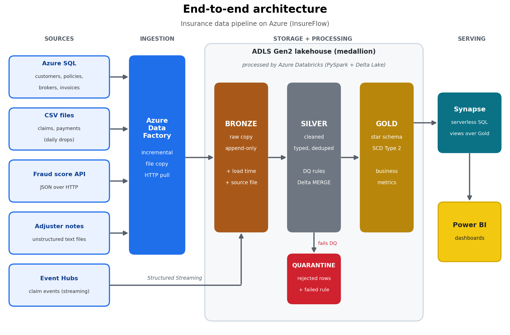
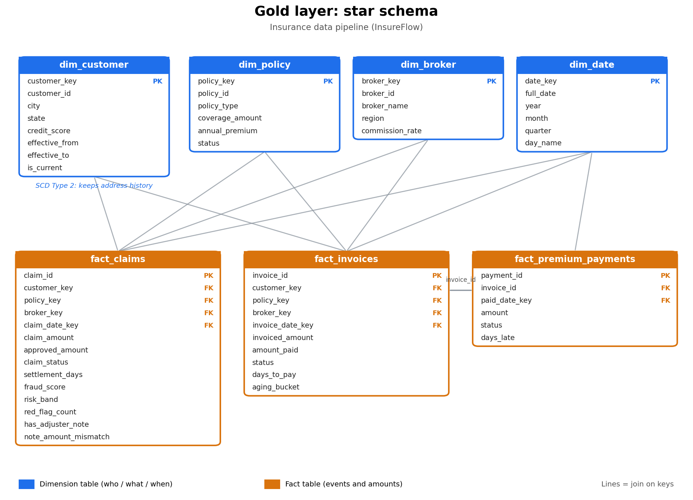

# InsureFlow: End-to-End Insurance Data Pipeline on Azure

*Medallion lakehouse with batch and streaming ingestion, data quality checks, and a star schema.*

An end-to-end data engineering project that ingests insurance data from structured, semi-structured, streaming, and unstructured sources into a medallion lakehouse on Azure, applies data quality rules and slowly changing dimensions, and serves business metrics (loss ratio, settlement time, collection rate, fraud risk).

All data is **synthetic**. It is modeled on the kinds of tables and problems common in the insurance domain and contains no real company data.

## Business problem
Claims, finance, and fraud teams rely on manual, inconsistent reports. This platform gives them one trusted, daily-refreshed source. Details in [`docs/business_requirements.md`](docs/business_requirements.md).

## Architecture



More diagrams (medallion detail, streaming, daily run) in [`docs/architecture.md`](docs/architecture.md).

## Data model

Gold layer star schema (full source model and column details in [`docs/data_model.md`](docs/data_model.md)):



## Tech stack
| Layer | Technology |
|---|---|
| Sources | Azure SQL, CSV files, REST API (JSON), Event Hubs, text files |
| Storage | ADLS Gen2, Delta Lake |
| Ingestion / orchestration | Azure Data Factory |
| Transformation | Databricks (PySpark) |
| Warehouse / serving | Azure Synapse (serverless SQL) |
| Reporting | Power BI |
| Security / monitoring | Key Vault, Azure Monitor |

## What this project demonstrates
- Multi-source ingestion: database, files, and HTTP API
- Incremental loading with a watermark, and idempotent re-runs
- Medallion architecture with Delta `MERGE` for records that arrive again with new status
- Data quality framework with a quarantine table and audit trail
- SCD Type 2 and a dimensional (star schema) model
- Handling schema drift without pipeline failure
- Unstructured data: parsing adjuster notes (free text) into features such as red-flag keywords and amounts, and comparing them with the fraud API score
- Streaming add-on: claim events via Event Hubs and Structured Streaming
- Cost-aware cloud design

## Repo structure
```
insurance-azure-data-pipeline/
├── data_generator/     synthetic data (history + 7 simulated days)
├── sql/                Azure SQL DDL and helper scripts
├── adf/                exported Data Factory pipelines (JSON)
├── databricks/         notebooks: bronze, silver, gold, streaming, common
├── synapse/            serverless SQL views
├── tests/              data quality and unit tests
└── docs/               architecture, data model, decisions, plan, runbook
```

## Key documents
- [Business requirements](docs/business_requirements.md)
- [Architecture](docs/architecture.md)
- [Data model](docs/data_model.md)
- [Design decisions](docs/decisions.md)
- [Project plan](docs/project_plan.md)
- [Runbook](docs/runbook.md)

## Status
- [x] Business requirements and data generator
- [ ] Azure setup and initial load
- [ ] ADF ingestion (SQL incremental, CSV, API)
- [ ] Silver layer: cleaning, DQ, quarantine, MERGE
- [ ] Gold layer: star schema, SCD2, metrics
- [ ] Synapse serving layer
- [ ] Streaming add-on
- [ ] Power BI dashboard

## Results
_To be filled with measured numbers after the runs (rows processed, records quarantined, load times)._

## Run it yourself
```
cd data_generator
python generate_insureflow_data.py
```
Then follow [`docs/runbook.md`](docs/runbook.md). Deployment steps will be added as each phase is completed.

## Lessons learned
_Added as the build progresses._
