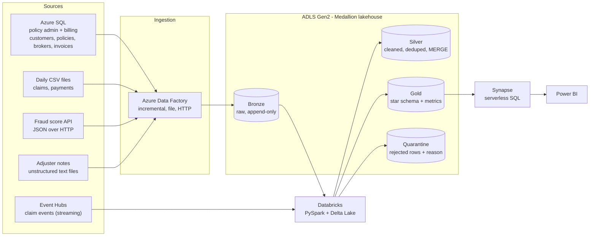
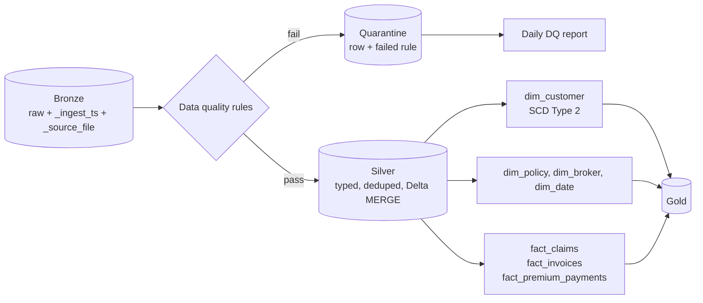
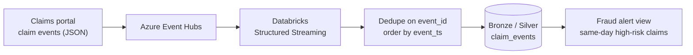
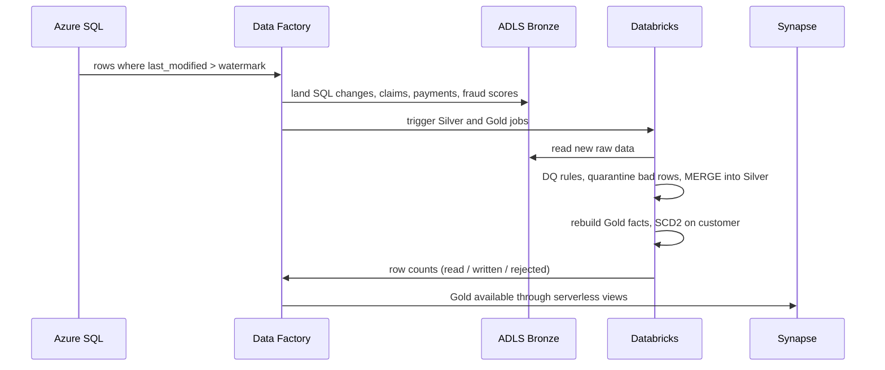

# Architecture

## 1. End-to-end architecture

## 2. Medallion layers: what happens inside Databricks

## 3. Streaming add-on: claim events

## 4. Daily run (simulated)

## Layers

| Layer | Purpose | Rules |
|---|---|---|
| Bronze | Exact copy of source data plus load metadata (`_ingest_ts`, `_source_file`) | Append-only, never modified |
| Silver | Cleaned, typed, deduplicated current state | Delta `MERGE` on business key; DQ rules applied; bad rows go to Quarantine |
| Gold | Business-ready star schema and metrics | Built from Silver; SCD Type 2 on customer |
| Quarantine | Rejected records with the rule they failed | Reviewed in the daily DQ report |

## Ingestion patterns

| Source | Pattern | Detail |
|---|---|---|
| Azure SQL (customers, policies, brokers, invoices) | Incremental | Watermark on `last_modified`, stored in a control table |
| Claims / payments CSV | File ingestion | One file per day, parameterized by date |
| Fraud API | HTTP pull | REST linked service, JSON to Bronze |
| Adjuster notes (.txt) | Unstructured file ingestion | Copied as-is to Bronze; Databricks reads the text and extracts amounts and red-flag keywords into Silver |
| Claim events | Streaming (add-on) | Event Hubs to Databricks Structured Streaming |

## Cross-cutting design

- **Idempotency:** every load can be re-run for the same day without creating duplicates (MERGE, not INSERT)
- **Schema drift:** Bronze keeps raw schema; Silver enforces an explicit schema and tolerates new columns
- **Observability:** each run logs rows read / written / rejected to an audit table
- **Secrets:** Key Vault, never in code or the repo
- **Cost control:** smallest cluster, auto-terminate, Synapse serverless only, whole project in one resource group that can be deleted in one step
