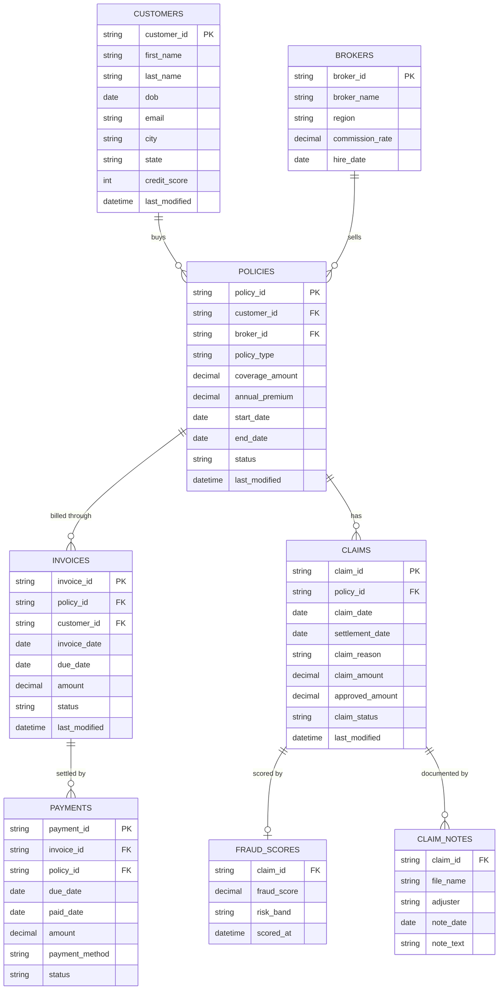

# Data model

## 1. Source model (operational systems)

Where each table lives: `customers`, `policies`, `brokers`, `invoices` in Azure SQL; `claims` and `payments` as daily CSV files; `fraud_scores` from the REST API; claim events (`ClaimSubmitted`, `DocumentsReceived`, `ClaimApproved`, `ClaimRejected`) from Event Hubs; and `claim_notes` as unstructured `.txt` adjuster notes, parsed in Databricks into the fields above (the three note-based columns in `fact_claims` are derived from the text).

## 2. Gold layer: star schema

```mermaid
erDiagram
    DIM_CUSTOMER ||--o{ FACT_CLAIMS : "customer_key"
    DIM_POLICY ||--o{ FACT_CLAIMS : "policy_key"
    DIM_BROKER ||--o{ FACT_CLAIMS : "broker_key"
    DIM_DATE ||--o{ FACT_CLAIMS : "claim_date_key"

    DIM_CUSTOMER ||--o{ FACT_INVOICES : "customer_key"
    DIM_POLICY ||--o{ FACT_INVOICES : "policy_key"
    DIM_BROKER ||--o{ FACT_INVOICES : "broker_key"
    DIM_DATE ||--o{ FACT_INVOICES : "invoice_date_key"

    FACT_INVOICES ||--o{ FACT_PREMIUM_PAYMENTS : "invoice_id"
    DIM_DATE ||--o{ FACT_PREMIUM_PAYMENTS : "paid_date_key"

    DIM_CUSTOMER {
        int customer_key PK
        string customer_id
        string city
        string state
        int credit_score
        date effective_from
        date effective_to
        boolean is_current
    }
    DIM_POLICY {
        int policy_key PK
        string policy_id
        string policy_type
        decimal coverage_amount
        decimal annual_premium
        string status
    }
    DIM_BROKER {
        int broker_key PK
        string broker_id
        string broker_name
        string region
        decimal commission_rate
    }
    DIM_DATE {
        int date_key PK
        date full_date
        int year
        int month
        int quarter
        string day_name
    }
    FACT_CLAIMS {
        string claim_id PK
        int customer_key FK
        int policy_key FK
        int broker_key FK
        int claim_date_key FK
        decimal claim_amount
        decimal approved_amount
        string claim_status
        int settlement_days
        decimal fraud_score
        string risk_band
        boolean has_adjuster_note
        int red_flag_count
        boolean note_amount_mismatch
    }
    FACT_INVOICES {
        string invoice_id PK
        int customer_key FK
        int policy_key FK
        int broker_key FK
        int invoice_date_key FK
        decimal invoiced_amount
        decimal amount_paid
        string status
        int days_to_pay
        string aging_bucket
    }
    FACT_PREMIUM_PAYMENTS {
        string payment_id PK
        string invoice_id FK
        int paid_date_key FK
        decimal amount
        string status
        int days_late
    }
```

## Design notes

- **Facts:** `fact_claims` (one row per claim), `fact_invoices` (one row per invoice, with aging bucket 0-30 / 31-60 / 60+), `fact_premium_payments` (one row per payment, linked to its invoice)
- **SCD Type 2 on `dim_customer`:** tracks city and state changes with `effective_from`, `effective_to`, `is_current`. To answer "where did the customer live when the claim was filed?", the fact joins to the dimension row valid on the claim date.
- **Other dimensions** are Type 1 (current state only)
- **Quarantine tables** hold rejected rows from each source with the rule they failed

## Metrics (built on Gold)
Loss ratio, average settlement time, premium collection rate, outstanding invoices by aging bucket, open-claim backlog and age, high-risk claim share by region and broker, agreement between note red flags and the fraud score.
